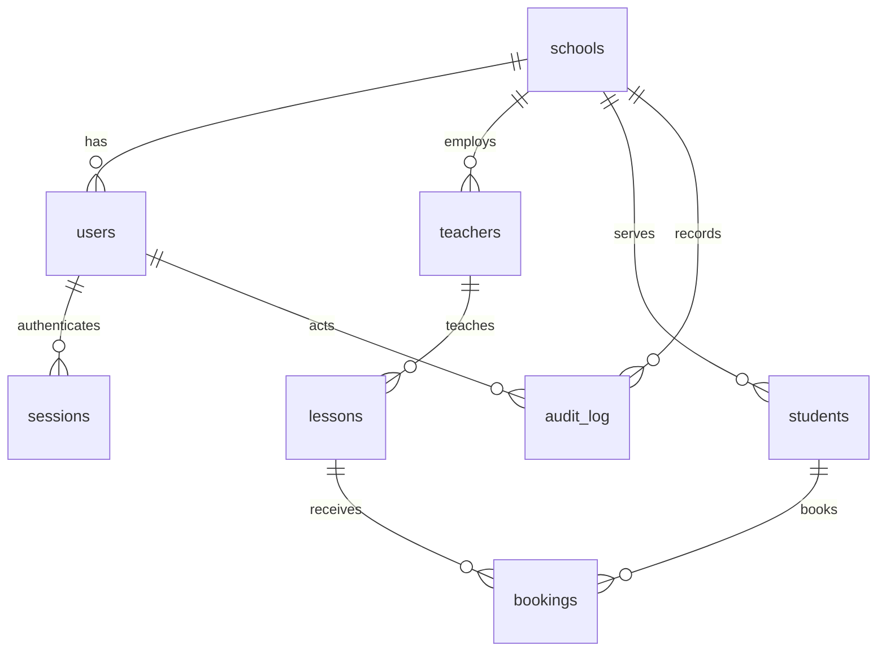

# Modelo da base de dados

A definição executável está em `database/migrations/001_initial.sql`. É SQL MySQL 8.4 com tabelas InnoDB, chaves estrangeiras, índices, unicidade e CHECK constraints. A migração é a fonte de verdade; não é necessário importar um dump adicional.

| Tabela            | Função                          | Restrições e índices principais                                                |
| ----------------- | ------------------------------- | ------------------------------------------------------------------------------ |
| schools           | Escola e fuso horário           | UUID primário; `Europe/Lisbon` nesta versão                                    |
| users             | Administrador da escola         | Email global único; password com scrypt; perfil owner                          |
| sessions          | Sessões de acesso               | SHA-256 do token; validade e FK para utilizador                                |
| teachers          | Instrutores                     | Chave composta única school_id + id; arquivo lógico                            |
| students          | Alunos                          | Email único dentro da escola; nível; arquivo lógico                            |
| lessons           | Aulas                           | Instrutor da mesma escola via FK composta; índice escola/data/instrutor/estado |
| bookings          | Inscrições em aulas             | Aluno e aula da mesma escola via FKs compostas; par aula/aluno único           |
| audit_log         | Rasto de alterações             | Escola, utilizador, ação, entidade e data                                      |
| schema_migrations | Controlo de versão da estrutura | Nome e SHA-256 do conteúdo da migração                                         |

IDs operacionais são UUIDs. Dinheiro é um inteiro em cêntimos de euro (`price_cents`). Uma reserva mantém o preço que foi apresentado quando foi criada. Não há floats monetários na BD.

## Datas e horários

`lesson_date` é um DATE e `start_time` é um TIME no fuso da escola, fixado a Europe/Lisbon neste MVP. `duration_minutes` é 60, 90 ou 120. A agenda aceita início em intervalos de 30 minutos e aulas dentro das 09:00–15:00. Carimbos técnicos (`created_at`, `expires_at`) usam UTC; o Docker oficial MySQL usa UTC por defeito. O cliente SQL também configura a ligação em UTC para DATETIME enviados por Node.

Para suportar outras regiões será necessário tornar o fuso editável, adaptar as regras e tratar explicitamente sessões em mudanças de hora. Os horários de surf deste MVP são diurnos.

## Concorrência

Todas as alterações da mesma escola executam uma transação InnoDB que primeiro faz `SELECT id FROM schools WHERE id=? FOR UPDATE`. Enquanto a transação está aberta, outra mutação da mesma escola espera. Escolas diferentes não partilham esse bloqueio.

A verificação da lotação, duplicados e conflitos é feita depois de adquirir o bloqueio e antes da escrita. A mesma regra cobre criação/edição de aulas, reservas e cancelamentos. O bloqueio de escola deve continuar a ser usado por qualquer novo caminho de escrita; escrever diretamente na BD pode contornar as regras de horários e capacidade.

## Estados e histórico

- Aula: `active` ou `cancelled`.
- Reserva: `confirmed` ou `cancelled`; pagamento `paid` booleano.
- Aluno/instrutor: `archived` booleano; não se apaga o histórico.
- Cancelar aula também cancela as reservas ativas nessa aula.
- Cancelar não altera `paid`. Não equivale a um reembolso.
- Uma reserva cancelada sem pagamento pode ser reativada pela nova reserva, com preço atual. Se tinha pagamento, o servidor bloqueia a reativação para evitar perder essa informação. Não há ainda endpoint de reembolso/reconciliação.
- Arquivar aluno/instrutor com aulas/reservas futuras ou em curso é bloqueado.

`audit_log` contém metadados das ações, não cópias de passwords ou dos dados pessoais. Não substitui um ledger financeiro nem uma auditoria contabilística. O endpoint devolve até 200 ações recentes. O histórico de cancelamentos devolve até 500 reservas recentes.

## Migrações

`npm run db:migrate` aplica os ficheiros `.sql` por ordem e guarda o seu checksum. Não edites migrações já aplicadas: cria `002_nome.sql`, etc. A ferramenta recusa checksums alterados e usa GET_LOCK para impedir dois processos de migração simultâneos.

MySQL faz commit implícito de DDL. Se uma migração falhar a meio, inspeciona e corrige o estado antes de repetir; não há promessa de rollback automático. Em ambiente local descartável podes recriar a BD depois de confirmar que não contém dados importantes. Em produção faz backup e prepara um plano de migração.
